# StockLite User Guide

Manage products, track stock, record sales, and review your business activity from your phone.

*Updated: 23 October 2026. This guide describes the current app. Button names may vary with your selected language. File import/export instructions below apply to Android; subscription availability depends on the installed release and store.*

Screenshots show Android in light and dark themes. Sample dates, quantities, and amounts are illustrative; your records may differ. Cropped images focus on the controls used in each step.

## Contents

- [Get started](#get-started)
- [Find your way around](#find-your-way-around)
- [Add and manage products](#add-and-manage-products)
- [Manage stock](#manage-stock)
- [Use barcodes](#use-barcodes)
- [Record a sale](#record-a-sale)
- [Understand reports](#understand-reports)
- [Export sales reports](#export-sales-reports)
- [Back up and restore your records](#back-up-and-restore-your-records)
- [Change your settings](#change-your-settings)
- [Use StockLite Pro](#use-stocklite-pro)
- [Build a daily routine](#build-a-daily-routine)
- [Troubleshooting](#troubleshooting)
- [Frequently asked questions](#frequently-asked-questions)

## Get started

StockLite stores your inventory and sales records locally on your device. You can manage products, adjust stock, record sales, and view saved reports without an internet connection. Store purchases, subscription verification, ads, and external pages may require internet access.

For your first session:

1. Open StockLite and finish the introductory tour.
2. Open **Settings → Currency** and choose your business currency before entering prices.
3. From **Dashboard**, tap **Add New Product**.
4. Enter the product’s name, variant, selling price, stock count, and low-stock limit, then save.
5. Repeat for the products you sell.
6. Tap **New sale** when you are ready to record a customer purchase.
7. After entering your opening inventory, create a backup through **Settings → Device backups → Back up now**.
8. On Android, export that backup to a separate storage location.

An example product might be “Bottled Water,” variant “500 ml,” price 20.00, initial stock 24, and low-stock limit 5. Use your own currency and actual figures.

## Find your way around

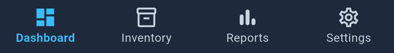

*Use these four tabs to move between the main areas of StockLite.*

| Tab | What you can do |
| --- | --- |
| **Dashboard** | See today’s revenue, inventory totals, and stock needing attention; start a sale or restock. |
| **Inventory** | Search products, filter low or empty stock, open product details, and manage products. |
| **Reports** | Review sales totals, payment breakdowns, sales details, and stock movement history. |
| **Settings** | Manage backups, currency, language, appearance, subscriptions, and app information. |

Dashboard revenue uses today’s local date and your selected app currency. It is a sales total, not a profit calculation.

## Add and manage products

### Add a product

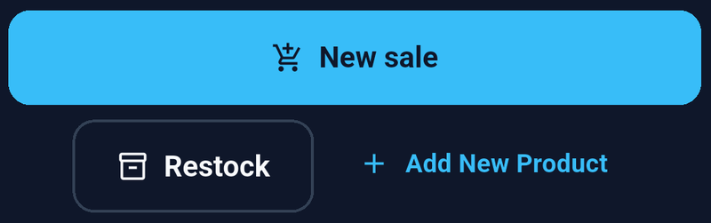

*Tap Add New Product to begin entering an item.*

1. Tap **Add New Product** on the Dashboard, or the add button in Inventory.
2. Choose an icon or use **Upload photo** to select a product image.
3. Complete the product fields.
4. Save the product and check that it appears in Inventory.

| Field | What to enter |
| --- | --- |
| **Product Name** | A clear name customers or staff recognize. |
| **Variant** | A size, color, flavor, or other identifying detail. Use “Regular” when appropriate. |
| **Barcode** | Optional. Type the printed code or scan it. Each code must belong to only one product. |
| **Price** | The selling price per unit in the selected currency. Zero is allowed; negative prices are not. |
| **Low Stock Limit** | A non-negative whole number that marks when the product needs attention. |
| **Initial Stock Count** | The number of units currently available, entered as a non-negative whole number. |

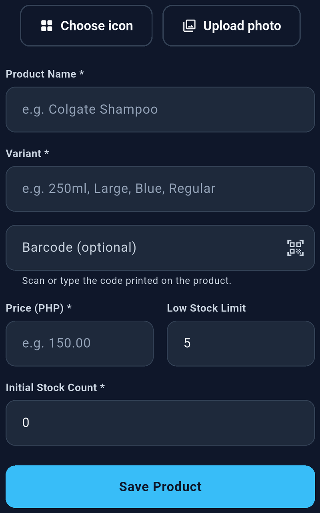

*Complete the required fields and tap Save Product. The barcode is optional; scroll if the save button is below the screen.*

Create separate products for variants you need to count independently, such as small and large bottles. Assign each variant its own barcode if you use scanning.

### Find and edit products

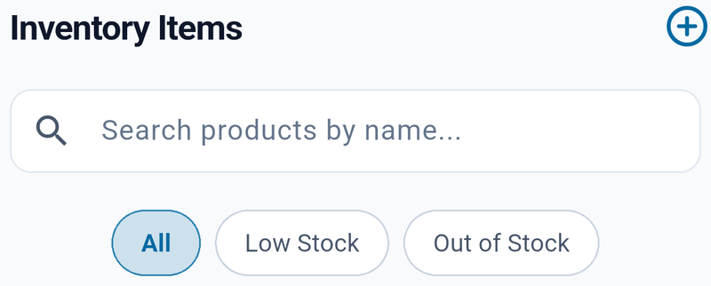

*Search by name or variant; clear the search and choose All to see every product.*

Open **Inventory** and search by product name or variant. Use **All**, **Low Stock**, or **Out of Stock** to narrow the list. Clear the search and select **All** if an item seems missing.

Open a product to view its details and movement history. Use its edit control to change product information, such as its name, variant, price, photo, barcode, or low-stock limit, then save. To change an existing stock count, use the stock controls described below.

### Delete a product

In Inventory, swipe a product to reveal the delete action and read the confirmation before choosing **Delete**. Choose **Cancel** to keep it.

Create a backup before removing products you may need again. Deleting a product is not a way to reverse a sale or issue a refund.

## Manage stock

### Understand stock status

- **Low stock:** The available quantity is greater than zero and at or below the product’s low-stock limit.
- **Out of stock:** The available quantity is zero.
- **Above the limit:** The product is not marked as low stock.

For a limit of 5, quantities 1–5 are low stock; 0 is out of stock. A limit of 0 means the product will only need attention when it runs out.

### Add received stock

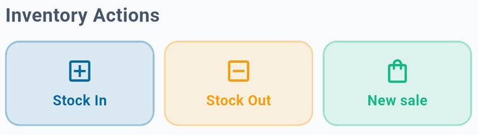

*Stock In adds units, Stock Out removes units, and New sale records a customer purchase.*

1. Open the product in Inventory.
2. Choose **Stock In (Add)**.
3. Enter the number of units received—not the new total quantity.
4. Optionally enter a reason, such as “Supplier delivery.”
5. Tap **Confirm** and check the updated quantity.

If you have 8 units and receive 12, enter 12. The new count becomes 20.

### Remove stock without making a sale

1. Open the product.
2. Choose **Stock Out (Reduce)**.
3. Enter the number of units to remove.
4. Add a useful reason, such as “Damaged goods” or “Count correction.”
5. Confirm the change.

Use a positive whole number. You cannot remove more units than are available. Stock Out changes inventory but does not record sales revenue. For customer purchases, use **New sale**, which records the sale and reduces stock together.

Review the product’s movement history to understand how its count changed.

## Use barcodes

### Assign a barcode

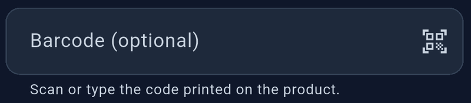

*Type the printed code or tap the scanner icon, then save the product.*

1. Add or edit a product.
2. Type the code in the barcode field, or tap its camera button.
3. If prompted, allow camera access.
4. Position one barcode clearly in view.
5. Save the product.

Keep any leading zeros when typing a code. StockLite preserves them. A barcode must be unique across products. To remove an assignment, clear the barcode field and save.

### Scan while selling

1. Open **New sale**.
2. Tap **Scan barcode**.
3. Scan a barcode already assigned to a product.
4. Check that one unit of the matching product was added to the cart.
5. Scan again to add another unit, or adjust the cart quantity.

Scanning does not create an unknown product automatically. An unrecognized or ambiguous code leaves the cart unchanged. The product must have sufficient stock.

The sale search also accepts barcode text. If the camera is unavailable or permission is denied, use the scanner’s manual-entry option. For reliable scanning, use good lighting and keep only one barcode in view.

## Record a sale

### Build and review the cart

1. Tap **New sale** from the Dashboard or a product’s details.
2. Find products using the sale search or **Scan barcode**.
3. Add products and adjust quantities with the cart controls.
4. Open the sale review and check each product, quantity, and amount.
5. Use **Add more products** if you need to return to product selection.

Adding items to a cart does not complete a sale. Stock changes when checkout succeeds. The app checks available stock again at checkout, so a quantity may need adjusting if inventory changed.

### Choose payment and discount

1. Select **Cash** or **GCash**.
2. If applicable, enter a discount amount. This is a currency amount, not a percentage.
3. Check **Total due**.
4. For Cash, enter **Amount paid**. It must cover the total due. Check the calculated change.
5. For GCash, verify receipt of the customer’s payment through your normal payment process before completing the sale.

Selecting GCash records the payment method in StockLite. It does not transfer money or verify a GCash payment.

The discount must be between zero and the cart subtotal. For example, a subtotal of 100.00 with a 10.00 discount gives a total due of 90.00. If the cash payment is 100.00, the change is 10.00.

### Complete the sale

Tap **Complete sale** once and wait for the receipt screen. Successful checkout records the sale, reduces stock, and adds stock movement entries. The receipt shows the transaction information and, for cash sales, payment and change details. Tap **New sale** to start the next transaction.

If checkout fails, read the message and correct the issue before trying again. If you are unsure whether it completed, check Reports before recording the same purchase again.

## Understand reports

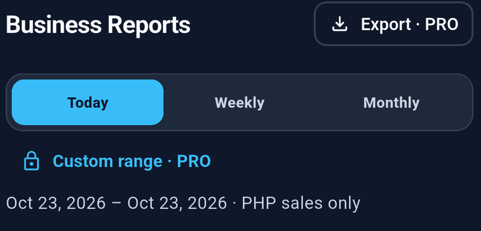

*Check the selected period and displayed dates before reading or exporting totals. PRO marks paid features.*

Open **Reports** and select a period. Check the displayed start and end dates.

| Period | What it includes |
| --- | --- |
| **Today** | The current calendar day according to your device’s local time. |
| **Weekly** | The current calendar week, Monday through Sunday. |
| **Monthly** | The current calendar month. |
| **Custom** | Your selected start and end dates, including both full days. Requires Pro. |

Weekly and monthly reports use calendar periods, not the last 7 or 30 days. Keep your device’s date, time, and time zone correct.

### Read the totals

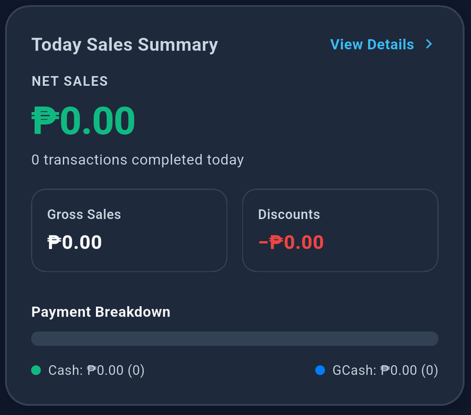

*This example has no sales for the selected period; View Details opens the breakdown.*

| Metric | Meaning |
| --- | --- |
| **Gross sales** | Recorded sales amounts before discounts. |
| **Discounts** | Discounts applied to the included sales. |
| **Net sales** | Gross sales minus discounts. |
| **Transactions** | Completed orders. A checkout with several products counts as one transaction. Older standalone sale records may count individually. |
| **Payment breakdown** | Included sales grouped by Cash and GCash. |

These totals describe recorded sales. They do not calculate profit after product costs or operating expenses, and they do not verify money in your cash drawer or payment account.

Open the sales breakdown to inspect the sales behind a selected period. Use the history feed to review inventory activity. History search and filters affect that feed; they do not change the sales summary or the exported sales report.

### Check the report currency

Reports initially use your app currency. Use the report-currency selector to review another currency.

Only sales recorded in the selected currency contribute to the monetary totals. StockLite does not combine different currencies using exchange rates. Older sales without a saved currency are treated as Philippine pesos (PHP).

If sales appear missing after changing currency, select the currency used when those sales were recorded. History entries retain their original sale currency.

## Export sales reports

**Requires StockLite Pro. Report exports are currently available on Android.**

1. Open **Reports**.
2. Select the date period and report currency.
3. Tap **Export**.
4. Choose **CSV** or **PDF**.
5. Tap the save button for that format.
6. Choose a destination in the Android file picker and finish saving.
7. Open the saved file to confirm its dates, currency, and totals before sharing it.

Choose CSV for spreadsheet analysis. It is a `.csv` file, not an Excel `.xlsx` workbook. Choose PDF for a readable report suitable for printing or sharing.

Exports contain the selected sales summary and sale lines. History-feed search does not limit the export. A period with no sales exports a zero summary; CSV still includes column headings. Cancelling the file picker does not save a report.

If some characters do not display correctly in a PDF, use CSV to retain the text for viewing in a compatible spreadsheet application.

A sales report is not a restorable backup. To protect your inventory, sales, movement records, and product photos, use Device backups.

## Back up and restore your records

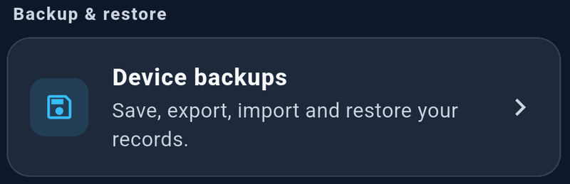

*Open Settings, then tap Device backups.*

Open **Settings → Device backups**. Local backup features are free.

### How automatic backups work

StockLite checks for automatic backups while the app is open and when you return to it. It creates at most one daily backup when records have changed and keeps the latest seven daily backups. Unchanged data may not produce a new backup.

Automatic checks run in the background without covering your screen. They are not continuous cloud synchronization. A daily backup may not include every sale made later that day; create a manual backup whenever you need a current snapshot.

Manual, imported, and recovery backups are kept separately from the seven daily backups. Backups include business records and product photos.

### Create a manual backup

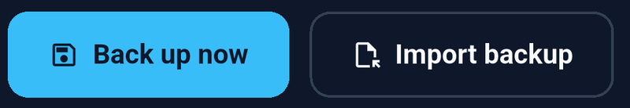

*Back up now saves the current records; Import backup loads an existing backup file into the list.*

1. Open **Device backups**.
2. Tap **Back up now**.
3. Wait for the success message.
4. Check the new entry in the backup list.

Create a manual backup after initial setup, before major inventory changes, before a restore, and at the end of a busy day.

### Export a backup on Android

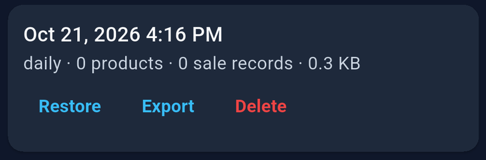

*Check the backup date and contents. Export saves a separate copy; Restore replaces current records.*

1. Create a current backup.
2. Find it in the list and tap **Export**.
3. Select a destination in the file picker.
4. Finish saving and verify the `.stocklite` file exists in that location.

**Keep a copy away from the device.** Device loss, failure, clearing app data, or uninstalling StockLite can remove local records and backups. A copy stored only on the same phone does not protect against losing that phone.

Exported backup files contain business records and are not encrypted. Store them somewhere you control and share them only with trusted recipients. Keep the `.stocklite` file intact; do not edit it in a text editor or spreadsheet.

### Import and restore on Android

1. Make the exported `.stocklite` file available on the destination device.
2. Open **Settings → Device backups → Import backup**.
3. Select the file and wait for import to finish.
4. Find the imported entry and check its date and record counts.
5. Tap **Restore** only when you are ready to replace the current records.
6. Read the confirmation and approve the restore.
7. Review your inventory and reports afterward.

Importing adds a backup to the list; it does not immediately change your live records.

**Restoring replaces the current records with the selected snapshot. It does not merge two devices’ data.** StockLite saves the previous records in a recovery backup before replacement. Transactions recorded after the selected snapshot will not be in the restored dataset. Create and export a current backup first if those transactions must be retained.

### Delete old backups

Tap **Delete** on the intended backup, check the confirmation, and confirm. This removes that local backup, not your current inventory or an already-exported copy. Keep at least one known-good copy before deleting older backups.

## Change your settings

### Currency

*Tap the currency option to choose the currency used for prices and new sales.*

Open **Settings → Currency** and choose a currency. Available choices include PHP, USD, EUR, GBP, JPY, CNY, INR, THB, SGD, AUD, CAD, AED, SAR, and KWD.

**Changing currency does not convert existing amounts.** A product price of 100 remains numerically 100. Check product prices before making sales in a different currency. New sales save the currency used at checkout; previous sales retain their recorded currency.

### Language and appearance

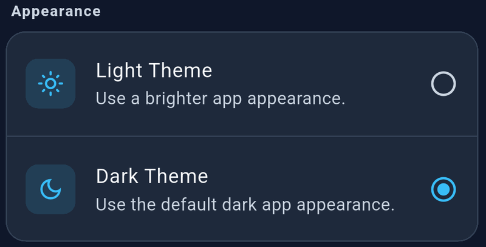

*The filled selection circle shows the active theme.*

Use **Settings → Language** to choose English, Filipino, Hindi, Spanish, Thai, or Simplified Chinese. Some screens or messages may still appear in English.

Use **Appearance** to select Light or Dark theme.

### App information and privacy

Open **Settings → About** for the installed app version and company information. Open **Privacy policy** to view the app’s published policy. **Ad privacy choices** appears when the advertising service requires that option.

## Use StockLite Pro

| Feature | Free | Pro |
| --- | --- | --- |
| Inventory and stock management | Yes | Yes |
| Checkout and barcode tools | Yes | Yes |
| Daily, weekly, and monthly reports | Yes | Yes |
| Local backups | Yes | Yes |
| Custom date reports | — | Yes |
| CSV and PDF sales exports on Android | — | Yes |
| Ad-free use | — | Yes |

Open **Settings → Subscription** to see available plans. Review the price and billing period shown in the app and store before confirming. If subscriptions are unavailable or no plans are displayed, you can continue using free features.

For an existing purchase, use **Restore purchases** with the same store account used to subscribe. If available, use **Refresh subscription** to check current access.

Use **Manage subscription**, when shown, or your store’s subscription settings to review or cancel a subscription. Follow the renewal and cancellation details displayed by the store. Your saved records and backups remain available if Pro expires.

Restoring purchases restores subscription access; it does not restore inventory or sales. Use a backup to recover business data.

## Build a daily routine

### Before opening

- Check low-stock and out-of-stock items.
- Record new deliveries with Stock In.
- Confirm product prices and the selected currency.

### During the day

- Record each customer purchase through New sale.
- Check quantities, discounts, and payment method before completing checkout.
- Record damaged or removed items with Stock Out and a clear reason.

### At closing

- Review Today’s sales and the Cash/GCash breakdown.
- Compare recorded totals with your actual payment records.
- Review unexpected inventory movements.
- Create a manual backup and export a separate copy.
- Export a sales report if needed and available.

## Troubleshooting

| Problem | What to check |
| --- | --- |
| A product is missing | In Inventory, clear the search and choose All. Search by name or variant. Check whether it was deleted or whether an older backup was restored. |
| A product is not marked low stock | Its count must be above zero and at or below the low-stock limit. Zero appears as out of stock. |
| A barcode is not recognized | Confirm the exact barcode is saved on the intended product. Preserve leading zeros. Try manual entry and scan only one code at a time. |
| Camera scanning is unavailable | Allow camera permission in the device’s app settings, then reopen scanning. Use manual entry if necessary. |
| The barcode is already used | Find the product with that code and correct or remove its assignment before assigning it elsewhere. |
| Checkout says insufficient stock | Review the current count and reduce cart quantities. Record an actual delivery with Stock In before selling it. |
| Cash checkout cannot finish | Enter an amount paid that covers the total due. Check that the discount is not negative or greater than the subtotal. |
| Sales totals seem too low | Check the report period, currency, and device time. Check for discounts and whether checkout completed. |
| History search does not change totals | This is expected: history filters affect the feed, not the sales summary or export. |
| Export does not work | Report exports require Pro and Android. Check available storage and the chosen destination, and finish the file-picker save action. |
| A backup fails | Check free storage. If a product photo is reported missing, select that photo again and retry. Backup files are limited to 100 MB. |
| A backup cannot be imported | Use a complete, unmodified `.stocklite` file. Damaged, unsupported, or oversized files cannot be used. Try another known-good copy. |
| The latest changes are absent after restore | The restored backup reflects its creation time. Check a newer backup or the recovery backup saved before restoration. |
| Pro is missing after purchase | Confirm internet access and the original store account, then use Restore purchases or Refresh subscription. |
| A loading indicator stays visible | Allow a manual backup, restore, or export to finish. If it remains stuck, note the screen and action, then reopen the app and check the result before repeating it. Avoid clearing app data. |

When requesting help through the app’s store listing support channel, include the app version from About, device model, operating system version, the steps that caused the issue, and the exact error message. If sharing a screenshot, hide private business or customer information. Do not post your backup file publicly.

## Frequently asked questions

### Does StockLite automatically sync between phones?

No. Records are stored locally. On Android, you can transfer a snapshot using backup export, import, and restore. Restoring replaces records; it does not combine activity from multiple phones.

### Can I use it offline?

Core inventory, checkout, and saved reporting functions work with local data. Purchases, subscription checks, external pages, and online storage destinations may need connectivity.

### Does GCash selection collect payment?

No. It labels the sale’s payment method. Verify the actual payment separately before completing the sale.

### Is a PDF or CSV report enough to recover my data?

No. Report files are for reviewing and sharing sales. Recovery requires a StockLite `.stocklite` backup.

### Can I undo a sale or process a refund?

The current app does not provide a dedicated sale reversal or refund workflow. Stock In can change a quantity but does not reverse sales revenue. Check the sale details before completion, and do not restore an old backup just to remove one transaction: that would replace other records too.

### Will a daily backup include my entire day’s activity?

Not necessarily. Automatic backups are limited to one per day and may be created before your final transaction. Create a manual backup at closing for a current snapshot.

### What happens if I uninstall the app?

Local records and backups can be removed. Export a current backup to a separate location before uninstalling, clearing app data, or changing devices.

### Are sales totals the same as profit?

No. Net sales subtract recorded discounts from gross sales. They do not subtract purchasing costs or business expenses.
